# 初墨阅读 · Chumo Reader

一个仿「番茄小说」阅读交互的**本地电子书阅读器**，Java + 原生 View 实现，**零第三方依赖**，最低兼容 Android 5.0（minSdk 21）。

不联网、不登录、不上传任何东西：书从本地导入，进度存在本地 JSON 里。

**下载安装**：[ChumoReader-v1.0.1.apk](https://github.com/cjh-china/chumo-reader/releases/latest)（145 KB，Android 5.0+）。7.1 及以下需在系统设置里允许「未知来源」；包用项目脚本生成的本地密钥签名，出现「未知开发者」提示属正常。

> v1.0.0 存在一处必崩缺陷（无封面的书会触发 `LruCache.get(null)`），请使用 v1.0.1 及以上。

## 截图

以下均来自 Android 14 模拟器（Pixel 5 规格，1080×2340 / 440dpi）实机运行：

| 书架 | 阅读 | 呼出菜单 | 目录 |
|---|---|---|---|
|  | 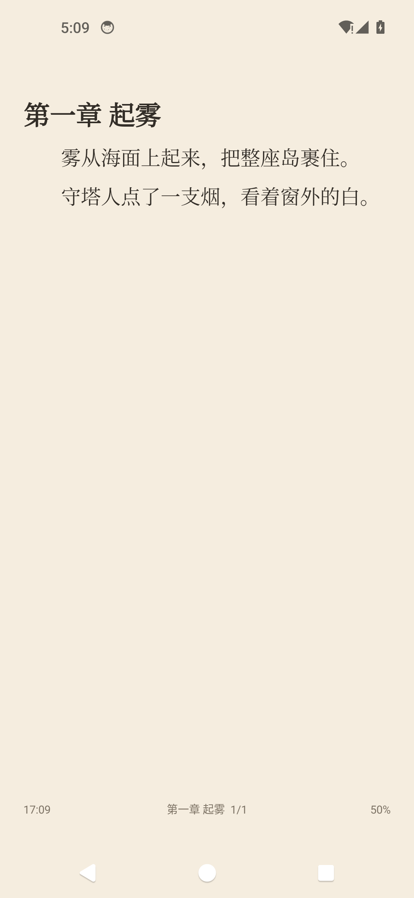 | 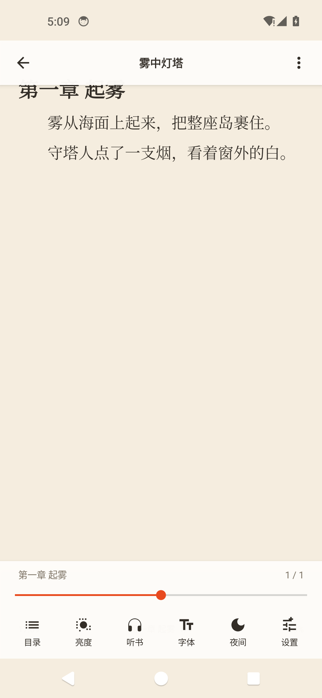 | 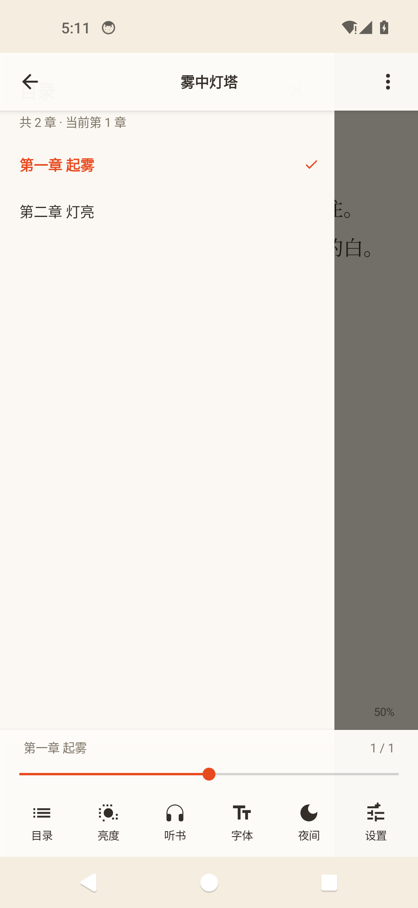 |

| 排版面板 | 夜间模式 | 书城 | 我的 |
|---|---|---|---|
| 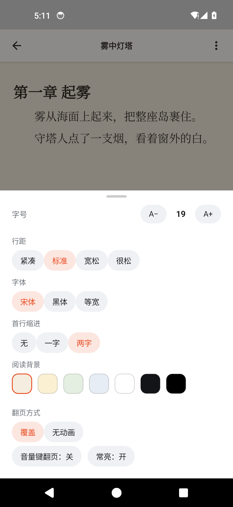 | 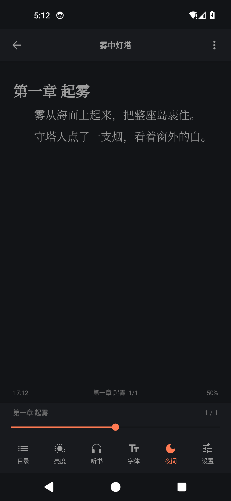 | 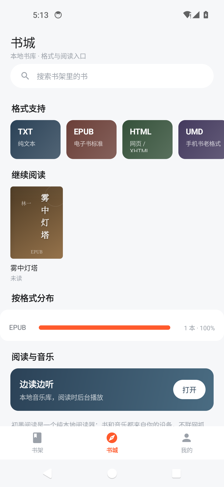 |  |

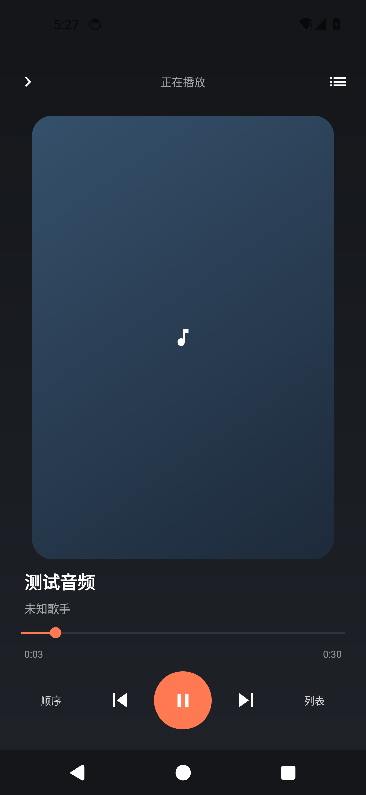


## 特性

**阅读器**
- 自绘分页：`StaticLayout` 按行高切页，不做整章滚动，翻页无抖动
- 跟手翻页：左右拖动实时跟随，松手按位移/速度决定翻过去还是弹回
- 点击分区：左侧上一页、右侧下一页、中间呼出上下栏
- 全屏沉浸，状态栏/导航栏配色随阅读主题联动，页脚显示时间、章节页码、全书百分比
- 长按取词：复制当前页文字

**排版与主题**
- 字号、行距、字体（衬线 / 无衬线 / 等宽）、首行缩进
- 7 套纸色背景 + 夜间模式，一处切换全局生效
- 音量键翻页、屏幕常亮、左边缘上下拖动调亮度

**书架**
- 网格封面，无封面时按书名自动生成竖排封面（渐变底 + 书脊阴影 + 格式角标）
- 继续阅读卡片、搜索、排序（最近阅读 / 书名 / 添加时间）、3·4·5 列切换
- 长按菜单：开始阅读、置顶、详情、删除（二次确认）
- 支持一次多选导入

**音乐**
- 扫描本地音频，迷你播放条常驻书架底部，可边读边听
- 全屏播放页、播放列表、循环模式
- 前台服务 + 媒体通知，切后台继续播
- **装了「初墨播放器」（`com.chumosplayer`）时，音乐入口直接跳转到它**，不再用内置播放器；入口文案会随检测结果变化

## 支持的文件格式

| 格式 | 说明 | 解析方式 |
|---|---|---|
| TXT | 纯文本 | 自动识别 UTF-8 / GBK / UTF-16（BOM + 严格校验 + GB18030 兜底），正则切章节 |
| EPUB | 电子书标准 | container.xml → OPF → spine，NCX/nav 取目录标题，提取封面与作者 |
| HTML | 网页 / XHTML | 容错剥离标签，保留段落与标题层级 |
| UMD | 早期手机书格式 | 扫描 zlib 流解包正文块 |
| MOBI | Kindle 旧格式（含 AZW） | PalmDOC 解压 + MOBI 头部解析 |
| AZW3 | Kindle KF8 | 按 KF8 文本块提取 |
| FB2 | FictionBook | XML 结构直接转段落 |
| PDF | 文档 | 系统 `PdfRenderer` 逐页渲染（图片模式） |
| CBZ | 漫画包 | 按图片条目自然序翻阅（图片模式） |
| DOCX | Word 文档 | 读 `word/document.xml`，识别 Heading 样式 |
| MD | Markdown | 标题 / 引用 / 分隔线 |
| RTF | 富文本文档 | 跳过字体表等控制组，`\'hh` 按 GB18030 还原中文 |

导入时用 `*/*` 选择器，非支持格式会被拦下并提示，不会产生坏书。

## 构建

没有用 Gradle，直接串 SDK 自带的命令行工具构建。

**前置条件**
- JDK 17
- Android SDK：`build-tools;34.0.0`、`platforms;android-34`

```bash
python build.py release    # 产物 build/ChumoReader-release.apk
python build.py debug      # 产物 build/ChumoReader-debug.apk
```

脚本按以下顺序找工具链，找不到会给出明确提示：
- SDK：`local.properties` 的 `sdk.dir` → `ANDROID_SDK_ROOT` / `ANDROID_HOME` → 常见安装路径
- JDK：`JAVA_HOME` → 常见安装路径

首次构建会用 `keytool` 自动生成本地签名密钥 `chumo-reader.jks`（口令 `chumo123`，仅供本机安装调试，**不要用于正式发布**）。

**为什么不用 Gradle**：这个项目起点是一台没有网络、拉不到 AGP 插件的机器。于是干脆绕开 Gradle，自己串 `aapt2 compile → aapt2 link → javac → d8 → zipalign → apksigner`，好处是全程离线、几秒出包；代价是没有依赖管理和增量编译——本项目零依赖，正好不吃这个亏。

## 目录结构

```
app/src/main/
├── AndroidManifest.xml
├── res/                     # 语义化主题属性、7 套纸色、28 个内联 vector 图标、自适应启动图标
└── java/com/chumoreader/
    ├── book/                # 12 种格式的解析层（各解析器 + Block/Chapter/ParseResult）
    ├── data/                # 书架持久化、导入、阅读偏好
    ├── music/               # 本地音频扫描 + MediaPlayer 前台服务
    ├── ui/                  # 自绘阅读视图、书架/书城/我的、弹层与通用组件
    ├── MainActivity.java    # 三 tab 容器 + 导入
    ├── ReaderActivity.java  # 阅读页：顶栏/底栏/目录抽屉/排版与亮度弹层
    └── MusicPlayerActivity.java
tools/                       # 解析层桌面端测试设施、图标预览脚本
```

界面全部用代码构建（没有 layout XML），主题色走 `?attr/appBg|appCard|appAccent` 这类语义属性，深色模式由 `values-night` 接管；阅读页的纸色由 `ReaderTheme` 的静态色表在运行时接管，不依赖资源切换。

## Android 5.0（API 21）兼容性

`minSdk` 是 21，但「能装」和「能跑」是两件事。下面是把 APK 装进 Android 5.0（1080×1920 / 480dpi，等效 360dp 宽的小屏）逐项点过的结果：

| 项目 | 结果 |
| --- | --- |
| 冷启动、三 tab 切换 | 正常，首帧约 0.8s |
| SAF 导入（TXT / EPUB / PDF / CBZ 四本一起选） | 正常 |
| TXT 分页排版、翻页、目录抽屉、夜间模式 | 正常 |
| PDF（系统 `PdfRenderer`）与 CBZ 位图渲染 | 正常，PDF 首页可作封面 |
| 音乐扫描、播放、前台通知（上一首/暂停/下一首） | 正常，API 21 不需要运行时权限 |
| 迷你播放条跨页保持 | 正常 |

| 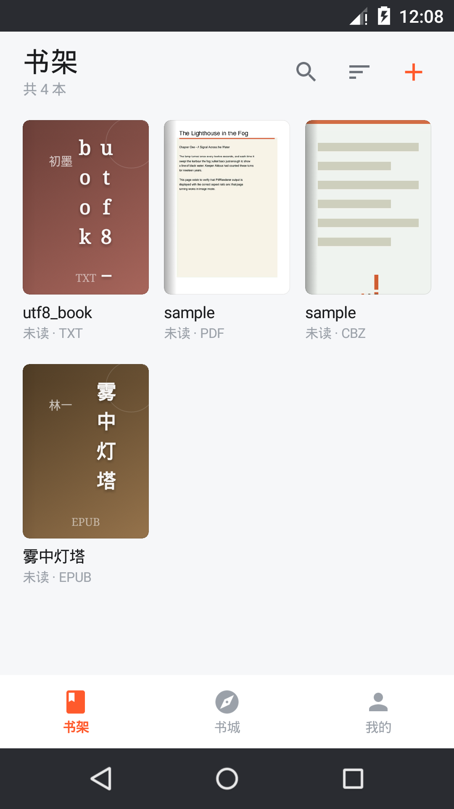 | 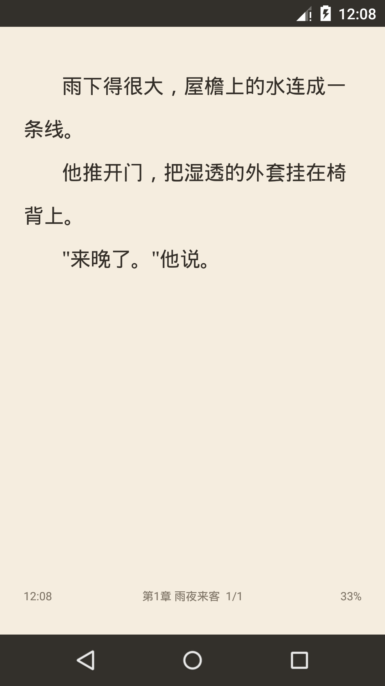 | 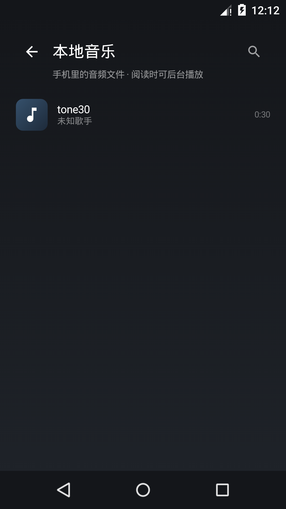 | 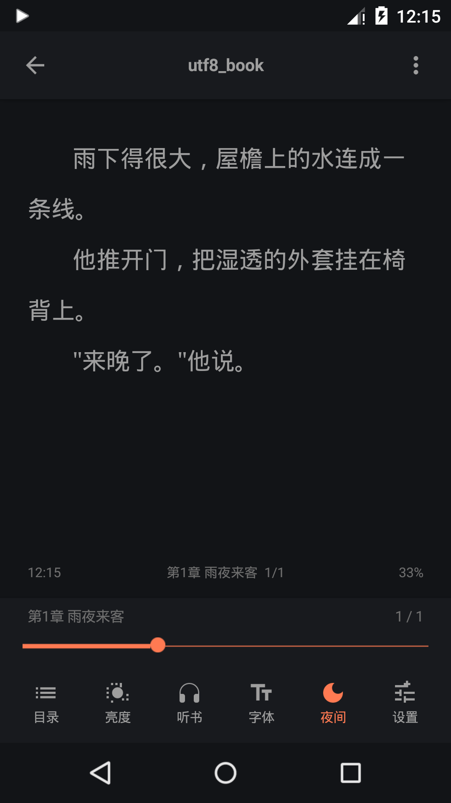 |
| --- | --- | --- | --- |
| Android 5 书架 | 阅读正文 | 本地音乐 | 夜间模式 |

这一轮实测修掉的两个问题：

- 阅读页顶栏书名显示成 16 位数字：书籍副本在库里以 id 命名，解析器把它当成了书名。现在书名以书库记录为准，解析结果只在书库没记时才采信
- 纯拉丁书名在封面上被逐字竖排成一列乱码：改为西文横排、最多三行、超长省略；中文书名仍走竖排

## 已知限制

- PDF / CBZ 是位图渲染，不能重排文字，也不支持划词与朗读
- MOBI 只支持 PalmDOC 压缩且未加密的文件，HUFF/CDIC 与 DRM 会明确报错而不是静默出错
- AZW3 按 KF8 文本块提取，复杂排版会退化成纯段落
- **UI 只在模拟器验证过**（Android 14 / 1080×2340 / 440dpi，以及 Android 5.0 / 1080×1920 / 480dpi），未在真机实测；超长屏机型的排版数值可能仍需微调
- 设备上没有语音引擎时，「听书」只会提示引擎不可用，不会崩

## 与「初墨播放器」联动

内置播放器是给「没装别的播放器」的人用的兜底。如果设备上已经装了本人的另一个项目
[初墨播放器](https://github.com/cjh-china)（包名 `com.chumosplayer`），书架、书城、我的三处音乐入口
都会直接拉起它，避免同一台机器上存在两套音乐库和两份播放状态。

- 检测走 `PackageManager.getLaunchIntentForPackage()`，Manifest 里声明了 `<queries>`，
  否则 Android 11+ 的包可见性会让它误判成「没装」
- 拉起失败（被停用、被卸载、无权限）会自动回退到内置播放器
- 入口副标题会显示「已装初墨播放器，将直接打开」，不是静默跳走

## 致谢

界面交互参考「番茄小说」；工程结构与主题组织方式与本人的另一个项目「初墨播放器」保持一致。
